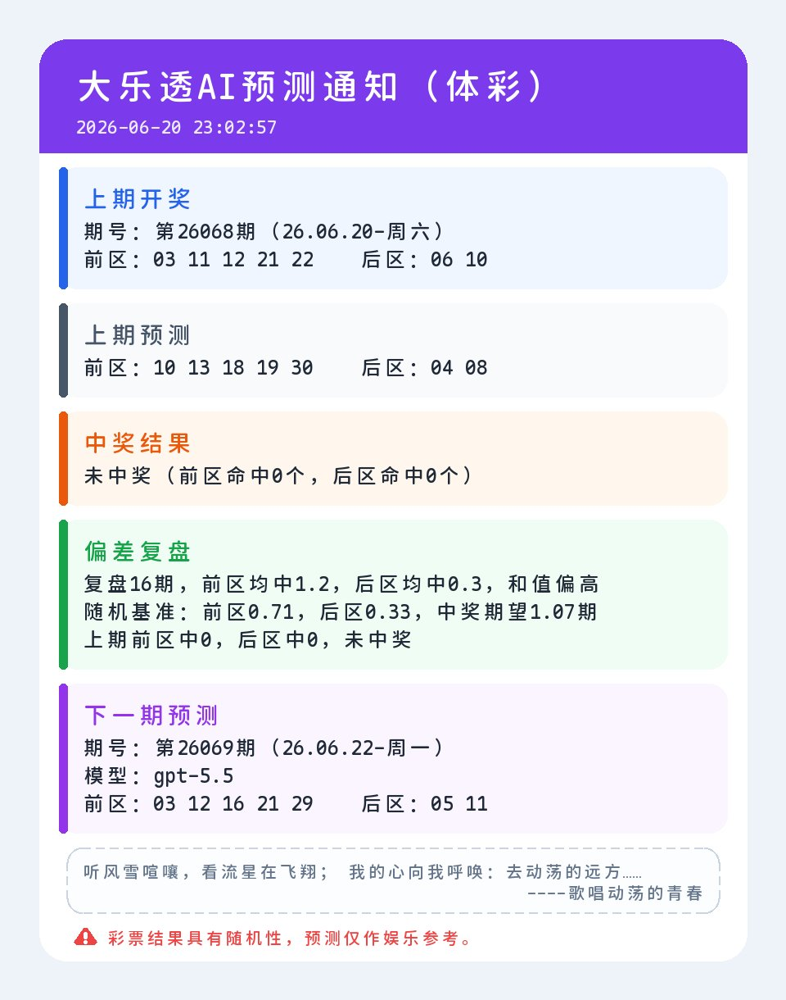

# 青龙脚本合集

本仓库包含以下几个青龙面板（Qinglong）定时脚本，统一使用**企业微信应用消息**推送通知：

| 脚本 | 用途 | 通知方式 |
| --- | --- | --- |
| [`lottery.py`](#lotterypy) | 彩票 AI 预测 | 企业微信应用：图片优先，失败回退文字 |
| [`bilibili.py`](#bilibilipy) | B 站每日任务（漫画签到、分享、投币、观看） | 企业微信应用：纯文字 |
| [`efuyou.py`](#efuyoupy) | e服药每日签到 | 企业微信应用：纯文字 |
| [`anyrouter_signin.py`](#anyrouter_signinpy) | anyrouter.top 自动签到（多账号） | 企业微信应用：纯文字 |
| [`fnnas.py`](#fnnaspy) | 飞牛 NAS 论坛签到 | 企业微信应用：纯文字 |
| [`newapi.py`](#newapipy) | New API 站点通用签到（多站点） | 企业微信应用：纯文字 |

## 通用通知配置

所有脚本共用同一套企业微信应用配置，推荐直接在青龙 **系统设置 → 通知设置** 中选择「企业微信应用」并填写 `weWorkAppKey`，脚本会自动读取 `/ql/data/config/config.sh`。

也可以在青龙「环境变量」中配置：

| 变量 | 说明 |
| --- | --- |
| `QYWX_AM` | 企业微信应用，格式：`corpid,corpsecret,touser,agentid`。`touser` 多个成员用 `\|` 分隔，`@all` 表示全部。 |
| `QYWX_CORPID` | 企业微信企业 ID，未配置 `QYWX_AM` 时使用。 |
| `QYWX_CORPSECRET` | 企业微信应用 Secret。 |
| `QYWX_TOUSER` | 接收成员，默认 `@all`。 |
| `QYWX_AGENTID` | 企业微信应用 AgentId。 |
| `QYWX_ORIGIN` | 企业微信 API 地址，默认 `https://qyapi.weixin.qq.com`。 |

示例（青龙通知设置里的 `weWorkAppKey` 同此格式）：

```bash
QYWX_AM=ww0123456789abcdef,你的应用Secret,@all,1000002
```

**注意：** 企业微信应用消息要求调用方 IP 在「应用管理 → 你的应用 → 企业可信 IP」白名单内，否则会返回 `60020 not allow to access from your ip`。请把青龙容器的公网出口 IP 加入白名单。

脚本内置的处理：

- `access_token` 自动缓存，提前 60 秒刷新；失效（`40014` / `42001`）时自动刷新并重试一次。
- 文字消息按 UTF-8 字节安全分片，单条不超过 2048 字节，不会截断中文。
- 图片消息超过 2MB 时自动降级为文字。
- 未配置企业微信时，把通知内容打印到运行日志，方便排查。

---

# lottery.py

彩票 AI 预测青龙脚本：自动获取最新开奖数据，核对上期预测结果，生成下一期预测，并通过企业微信应用推送结果。

> 彩票开奖结果具有随机性，本脚本生成的预测仅供娱乐和技术研究参考，不构成任何投注建议。

## 通知示例



## 功能特性

- 自动抓取 500.com 历史开奖数据。
- 支持多种彩票类型：大乐透、双色球、7 星彩、排列 3、福彩 3D、七乐彩。
- 调用 OpenAI 兼容接口生成下一期预测号码。
- 自动核对历史预测与实际开奖结果。
- 基于近期预测偏差生成复盘信息，用于辅助下一轮提示词。
- 将预测、复盘、中奖核对结果保存到本地 JSON 数据文件。
- 支持企业微信应用图片通知，图片不可用时自动回退为文字通知。
- 内置离线自检模式，便于验证核心逻辑是否正常。

## 环境要求

- Python 3.10+
- 青龙面板或其他可定时执行 Python 脚本的环境

安装依赖：

```bash
pip install requests beautifulsoup4 pillow python-dotenv
```

其中：

- `requests`：请求开奖数据、AI 接口和通知接口。
- `beautifulsoup4`：解析开奖历史页面。
- `pillow`：生成图片通知，可选但推荐安装。
- `python-dotenv`：本地调试时读取 `.env`，可选。

## 快速开始

运行脚本：

```bash
python lottery.py
```

运行离线自检：

```bash
python lottery.py --self-test
```

离线自检不会联网、不会发通知、不会保存数据，也不要求配置 AI API Key。

## 环境变量

### AI 接口配置

| 变量 | 默认值 | 说明 |
| --- | --- | --- |
| `LOTTERY_API_KEY` | 无 | AI 接口密钥，必填。 |
| `LOTTERY_BASE_URL` | 无 | OpenAI 兼容接口地址，脚本会请求 `{LOTTERY_BASE_URL}/chat/completions`，必填。 |
| `LOTTERY_MODEL` | `gpt-5.5` | 主模型名称。 |
| `LOTTERY_FALLBACK_MODEL` | `gemini-3-flash-preview` | 主模型失败时使用的容错模型。 |
| `LOTTERY_MAX_TOKENS` | `1200` | AI 最大输出 token 数。 |
| `LOTTERY_TEMPERATURE` | `0.2` | AI 采样温度。 |
| `LOTTERY_SEED` | `42` | AI 随机种子；留空则不传。 |

### 彩种配置

| 变量 | 默认值 | 说明 |
| --- | --- | --- |
| `LOTTERY_ENABLE_TYPES` | 全部彩种 | 启用的彩种，多个用逗号、分号或空格分隔。 |

支持的彩种代码：

| 代码 | 彩种 | 开奖类型 |
| --- | --- | --- |
| `dlt` | 大乐透 | 体彩 |
| `ssq` | 双色球 | 福彩 |
| `qxc` | 7 星彩 | 体彩 |
| `pl3` | 排列 3 | 体彩 |
| `fc3d` | 福彩 3D | 福彩 |
| `qlc` | 七乐彩 | 福彩 |

示例：

```bash
LOTTERY_ENABLE_TYPES=dlt,ssq,fc3d
```

### 通知配置

通知使用企业微信应用，配置方法见上方[通用通知配置](#通用通知配置)。

| 变量 | 默认值 | 说明 |
| --- | --- | --- |
| `QYWX_AM` 等 | 无 | 企业微信应用配置，见通用通知配置。 |
| `HITOKOTO` | `true` | 是否在图片通知中附加每日一言，设置为 `false` 可关闭。 |
| `LOTTERY_FONT_PATH` | 无 | 图片通知中文字体路径。 |

图片通知需要安装 `pillow`；未安装或生成失败时，脚本会改为发送文字通知。

如果图片通知出现中文乱码、方块字或字体显示异常，可以上传一个中文字体文件到青龙面板脚本目录，例如 `/ql/data/scripts/msyh.ttc`、`/ql/data/scripts/simhei.ttf` 或 `/ql/data/scripts/NotoSansCJK-Regular.ttc`，然后将 `LOTTERY_FONT_PATH` 设置为该字体文件的完整路径。

## 数据文件

脚本会在同目录下维护：

```text
lottery_data.json
```

该文件用于保存：

- 历史开奖缓存
- 预测记录
- 已核对的开奖结果
- 通知指纹，避免重复推送相同内容

`lottery_data.json` 包含运行缓存和预测记录，公开仓库通常不需要提交该文件。

## 青龙面板配置示例

定时任务命令：

```bash
python3 lottery.py
```

示例环境变量：

```bash
LOTTERY_API_KEY=your_api_key
LOTTERY_BASE_URL=https://your-openai-compatible-api.example.com/v1
LOTTERY_MODEL=gpt-5.5
LOTTERY_ENABLE_TYPES=dlt,ssq,pl3,fc3d
QYWX_AM=your_corpid,your_corpsecret,@all,1000002
HITOKOTO=false
```

## 本地调试

脚本同目录可创建 `.env` 文件用于本地调试：

```env
LOTTERY_API_KEY=your_api_key
LOTTERY_BASE_URL=https://your-openai-compatible-api.example.com/v1
LOTTERY_MODEL=gpt-5.5
LOTTERY_ENABLE_TYPES=dlt,ssq
HITOKOTO=false
```

`.env` 通常包含密钥等敏感配置，不应提交到公开仓库。

---

# bilibili.py

B 站每日任务青龙脚本，支持多账号，执行后推送企业微信文字通知。

## 功能

- 漫画签到、分享视频、投币、观看视频上报。
- 多账号用 `###` 分隔 Cookie。
- 自动获取排行榜/动态视频作为投币和分享目标。
- 统计等级、经验、硬币与升级所需天数，汇总到通知里。

## 环境变量

| 变量 | 默认值 | 说明 |
| --- | --- | --- |
| `BILIBILI_COOKIE` | 无 | B 站 Cookie，必填，多账号用 `###` 分隔。 |
| `TASK_CONFIG` | `manga_sign,share_video,add_coin` | 任务列表；`live_sign` 已失效，会自动忽略。 |
| `COIN_ADD_NUM` | `1` | 每日投币数量，`0` 跳过。 |
| `COIN_SELECT_LIKE` | `1` | 投币时是否点赞。 |
| `COIN_VIDEO_SOURCE` | `dynamic` | 投币视频来源：`dynamic` 或 `ranking`。 |
| `WATCH_SECONDS` | `30` | 观看视频上报秒数。 |
| `HITOKOTO` | `true` | 是否在通知末尾附加每日一语。 |

通知配置见[通用通知配置](#通用通知配置)。

## 定时建议

```text
30 8 * * *
```

---

# efuyou.py

「e服药助手」小程序每日签到青龙脚本，支持多账号，支持账号密码自动登录并在 token 失效时自动刷新。

## 环境变量

| 变量 | 说明 |
| --- | --- |
| `EFUYAO_TOKEN` / `EFUYAO_USER_ID` | 直接使用抓包得到的 token 与 userId，需成对配置，多账号用 `&`、`###` 或换行分隔。 |
| `EFUYAO_LOGIN_NAME` / `EFUYAO_PASSWORD` | 推荐方式：配置账号密码，脚本每次运行自动登录获取最新 token。 |
| `EFUYAO_SSL_VERIFY` | 是否校验 HTTPS 证书，`1` 是，`0` 否，默认 `0`。 |
| `HITOKOTO` | 是否在通知末尾附加每日一言，默认 `true`。 |

同时配置 token 和账号密码时优先使用 token，接口返回鉴权失效时自动重新登录并重试。

## 定时建议

```text
10 8 * * *
```

---

# anyrouter_signin.py

anyrouter.top 自动签到青龙脚本，支持多账号，内置阿里云 WAF `acw_sc__v2` 挑战求解。

> 作为 `notify.py` 的替代，本脚本直接使用企业微信应用发送通知，不依赖青龙通知脚本。

## 环境变量

| 变量 | 说明 |
| --- | --- |
| `ANYROUTER_ACCOUNTS` | 必填，JSON 数组：`[{"user_id":"165045","access_token":"xxx"}]`。每个账号需 `user_id`，并提供 `access_token` 或 `cookie` 至少一项。 |
| `ANYROUTER_PROXY` | 可选，代理地址，例如 `http://127.0.0.1:7890`。国内直连常被 TLS 重置，签到报网络错误时配置。 |

`access_token` 为长效凭证，推荐优先使用；`cookie` 会较快过期，作为兜底。

**注意：** 企业微信通知走独立直连通道，不经过 `ANYROUTER_PROXY`，避免出口 IP 与可信 IP 白名单不一致。

## 定时建议

```text
5 8 * * *
```

---

# fnnas.py

飞牛 NAS 论坛（club.fnnas.com）每日打卡青龙脚本。

## 环境变量

| 变量 | 说明 |
| --- | --- |
| `FNNAS_COOKIE` | 飞牛论坛 Cookie，必填。也兼容 `FNNASCLUB_COOKIE`。 |
| `HITOKOTO` | 是否在通知末尾附加每日一言，默认 `true`。 |

通知配置见[通用通知配置](#通用通知配置)。

## 定时建议

```text
15 8 * * *
```

---

# newapi.py

New API 站点通用签到青龙脚本，支持多站点批量签到。

## 环境变量

| 变量 | 说明 |
| --- | --- |
| `NEW_API_TOKENS` | 必填，JSON 数组：`[{"name":"站点A","website":"https://a.example.com","user":"1234","session":"xxxx"}]`。 |
| `HITOKOTO` | 是否在通知末尾附加每日一言，默认 `true`。 |

通知配置见[通用通知配置](#通用通知配置)。

## 定时建议

```text
20 8 * * *
```

---

## 免责声明

本项目仅用于 Python 脚本编写、自动化任务、数据抓取与 AI 接口调用等技术学习场景。彩票预测没有确定性，任何基于本脚本输出进行的决策均由使用者自行承担风险。

## 致谢

- [LINUX DO](https://linux.do) — 中文开发者社区，感谢社区里关于 AI 代理、技能、自媒体工作流程和内容生产实践的讨论。

## License

本项目基于 MIT License 开源，详见 [LICENSE](LICENSE)。
